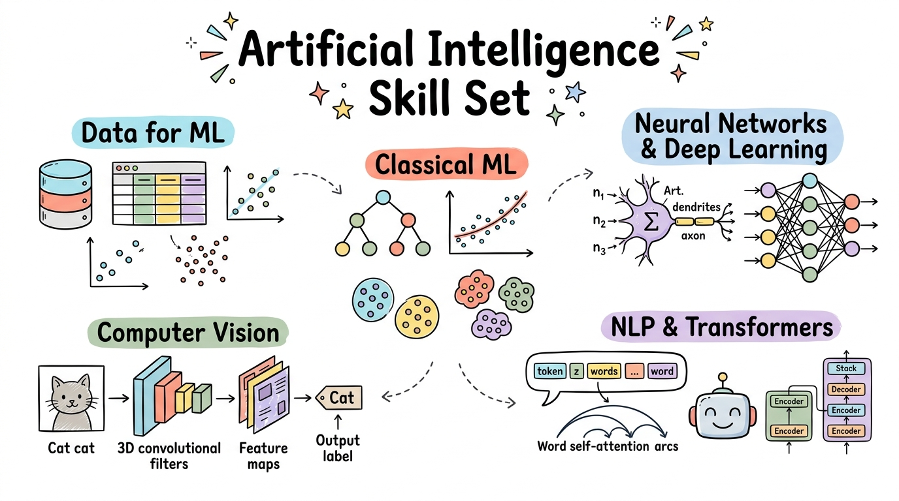

# Artificial Intelligence Skill Set

[](LICENSE)
[](https://github.com/wlos/AI_SS/graphs/contributors)
[](https://github.com/wlos/AI_SS/issues)
[](https://github.com/wlos/AI_SS/pulls)
[](https://github.com/wlos/AI_SS/pulls)

[](https://github.com/wlos/AI_SS/watchers)
[](https://github.com/wlos/AI_SS/network/members)
[](https://github.com/wlos/AI_SS/stargazers)
[](https://mybinder.org/v2/gh/wlos/AI_SS/main)
[](https://github.com/wlos/AI_SS/discussions)



Welcome to the **Artificial Intelligence Skill Set** curriculum. This course provides vocational learners and practitioners with practical foundations in artificial intelligence and hands-on machine learning. Through guided lecture notebooks, interactive visualisations, and hands-on laboratory exercises, students explore end-to-end data preparation, classical machine learning algorithms, deep learning fundamentals, computer vision with convolutional neural networks, and fine-tuning modern Transformer models.

- 🌐 **Course Website**: <https://wlos.github.io/AI_SS/>
- 🗺️ **Interactive Roadmap**: [Mindmap of the Course](https://wlos.github.io/AI_SS/mindmap.html)

## 🛠️ What You'll Build

### 🎯 Core Competencies

- **Data & Feature Engineering**: Prepare structured tabular, text, and image datasets, handling missing values, encoding, and bias mitigation.
- **Applied Machine Learning**: Build, evaluate, and tune regression, classification, and unsupervised clustering pipelines with scikit-learn.
- **Deep Learning & Computer Vision**: Construct custom CNN architectures, train PyTorch vision classifiers, and apply transfer learning with pretrained ResNet models.
- **Modern NLP & Transformers**: Master tokenisation, embeddings, and self-attention, fine-tuning DistilBERT and GPT-2 models with Hugging Face.
- **Responsible AI & Opportunity Framing**: Frame real-world AI use cases balancing capability, ethical governance, safety, and continuous monitoring.

### 🏗️ Practical Projects

- **California Housing Valuation Engine**: Multi-feature regression model with feature scaling, cross-validation, and error diagnostics.
- **MNIST Digit Classifier**: Multi-class visual classification comparing classical algorithms against PyTorch convolutional neural networks.
- **Gatys Neural Style Transfer**: Artistic image synthesis blending content and style representations using convolutional feature maps.
- **ResNet-18 Transfer Learning Classifier**: End-to-end PyTorch image dataset loader, augmentations, and transfer-learning fine-tuning.
- **Support Ticket Transformer Classifier**: Fine-tuned DistilBERT transformer predicting IT support query categories with Hugging Face.

### 🏢 Industry Applications

Manufacturing & Predictive Maintenance · Healthcare Diagnostics · FinTech & Fraud Detection · E-Commerce Recommendations · IT Service Desk Automation

## 💼 Career Impact

- **Technical Roles**: Machine Learning Engineer · Applied AI Developer · Computer Vision Engineer · Data Scientist · AI Solutions Specialist
- **Industry Sectors**: Technology & Cloud Services · Banking & FinTech · Healthcare Technology · E-Commerce & Retail · Public Sector & Education
- **Portfolio Projects**: Production scikit-learn pipelines · Custom PyTorch vision models · Pretrained ResNet transfer learning · Fine-tuned Hugging Face transformer classifiers

## 📚 Content

The course is organised into modular sessions located directly under the repository root. Supplementary lectures are grouped within their respective session folders, and practice notebook entries are integrated directly into each companion lecture.

| Module | Topic | Focus Area | Key Content |
| :---: | :--- | :--- | :--- |
| 📖 [01](01-Introduction-to-AI) | [Introduction to AI](01-Introduction-to-AI) | Foundation & History | AI, ML & DL Relationships · AI Milestones · Perceptrons · Activation Functions · Deep Learning Basics |
| 📊 [02](02-Data-for-Machine-Learning) | [Data for Machine Learning](02-Data-for-Machine-Learning) | Data Preparation & Quality | Structured & Unstructured Data · Features & Targets · Data Cleansing · Bias & Fairness · Train/Test Splits |
| 🧠 [03](03-Machine-Learning-Essentials) | [Machine Learning Essentials](03-Machine-Learning-Essentials) | Classical ML Algorithms | Linear Regression · K-Nearest Neighbours · Decision Trees · Random Forests · Gradient Boosting · scikit-learn Pipelines |
| 🔬 [04](04-Machine-Learning-Case-Studies) | [Machine Learning Case Studies](04-Machine-Learning-Case-Studies) | Regression, Classification & Clustering | California Housing · Diabetes Prediction · Linnerud Multi-output · MNIST Digit Classification · Wine K-means Clustering |
| 💼 [05–06](05-06-AI-Opportunities) | [AI Opportunities](05-06-AI-Opportunities) | Industry Applications & Ethics | Opportunity Framing · Recommender Systems · HR Attrition · Document Classification · Intrusion Detection · Responsible AI |
| 📐 [08](08-Machine-Learning-Evaluation) | [Machine Learning Evaluation](08-Machine-Learning-Evaluation) | Validation & Metrics | Confusion Matrix · Precision & Recall · ROC-AUC · Regression Metrics · Overfitting vs Underfitting · Cross-Validation |
| ⚡ [09–10](09-10-Deep-Learning) | [Introduction to Deep Learning](09-10-Deep-Learning) | Deep Learning Architectures | Neural Network Fundamentals · Loss Functions & Optimisers · CNNs · RNNs · Transformers · Framework Overview |
| 🖼️ [11](11-CNN-Image-Processing) | [Deep Learning for Image Processing with CNNs](11-CNN-Image-Processing) | Convolutions & Neural Style Transfer | Convolution & Pooling Layers · Modern CNN Evolution · ResNet Architecture · Gatys Neural Style Transfer · Feature Optimisation |
| 🏗️ [12](12-Building-and-Training-CNNs) | [Building and Training CNN Models with PyTorch](12-Building-and-Training-CNNs) | PyTorch Model Development | nn.Module Design · Forward Pass · PyTorch Training Loop · Model Evaluation · TorchScript Export · Hands-on CNN Practice |
| 👁️ [13](13-Computer-Vision) | [Image Classification and Computer Vision Applications](13-Computer-Vision) | Vision Workflows & Advanced Models | Datasets & Transforms · DataLoader Batches · Transfer Learning with ResNet18 · YOLO & DETR Object Detection · GANs & Diffusion |
| 🤖 [14–15](14-15-Sequence-Models-and-Transformers) | [Sequence Models and Transformer Applications](14-15-Sequence-Models-and-Transformers) | NLP & Transformer Fine-tuning | Tokenisation & Embeddings · Self-Attention · Encoder vs Decoder Architectures · DistilBERT & GPT-2 · Hugging Face Ticket Classification |

## 🚀 Getting Started

### 🌐 Course Website

You can study all course notes and visual walk-throughs online without installing software by visiting the [Course Website](https://wlos.github.io/AI_SS/).

### ☁️ Hands-on Activities in Google Colab

Every practice notebook includes an **Open in Colab** link inside the corresponding lecture. In Colab:

1. Click **Open in Colab** from the lecture page.
2. Select an appropriate runtime (a CPU runtime is sufficient for Sessions 12 and 13.1–13.2; select a T4 GPU runtime for Session 13.3 and Sessions 14–15).
3. Run the notebook from top to bottom. Each notebook automatically fetches required dataset files and installs supplementary packages, without requiring a local repository checkout.

### 💻 Running Locally

To work with the notebooks and code on your local computer:

1. Clone this repository and change into the course directory:
   ```bash
   git clone https://github.com/wlos/AI_SS.git
   cd AI_SS
   ```

2. Create and activate a Python virtual environment (Python 3.10 or newer is recommended):
   ```bash
   python3 -m venv .venv
   source .venv/bin/activate
   ```

3. Install course dependencies:
   ```bash
   pip install numpy pandas matplotlib seaborn scikit-learn torch torchvision transformers datasets evaluate accelerate kagglehub pillow openpyxl jupyter
   ```

4. Start JupyterLab or Jupyter Notebook:
   ```bash
   jupyter lab
   ```

5. To preview the published Quarto documentation site locally:
   ```bash
   quarto preview
   ```

## 🎓 Other Curricula

- 🔌 [Build AI Apps with REST API & MCP](https://wlos.github.io/Connect-AI-using-REST-API/) · [GitHub](https://github.com/wlos/Connect-AI-using-REST-API): REST APIs, FastAPI microservices, and Model Context Protocol (MCP).
- 🧠 [Introduction to AI with Python](https://wlos.github.io/ai_with_python_course/) · [GitHub](https://github.com/wlos/ai_with_python_course): Programming fundamentals, algorithms, robotics with micro:bit & Maqueen, and basic AI.
- 📊 [Data Analysis with Python](https://wlos.github.io/DA_with_Python/) · [GitHub](https://github.com/wlos/DA_with_Python): Full data analysis pipeline, Pandas, Matplotlib / Seaborn visualisations, and statistical testing.

## 📄 License

This course and its materials are licensed under the [MIT License](LICENSE).
