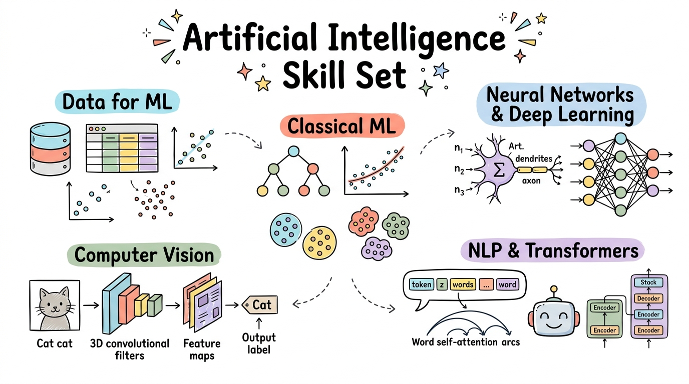

::: {.course-hero}
::: {.course-kicker}
TAFE COURSE MATERIALS
:::

# Artificial Intelligence Skill Set

Welcome to the **Artificial Intelligence Skill Set** curriculum. Explore foundational concepts in artificial intelligence, master practical data skills for machine learning, train classical algorithms, construct convolutional neural networks with PyTorch, and fine-tune modern Transformer models with Hugging Face.

[Browse curriculum](#curriculum){.btn .btn-primary .btn-lg} [Getting started](#getting-started){.btn .btn-outline-light .btn-lg}
:::

::: {.course-banner-container}
{.course-banner-img fig-alt="Artificial Intelligence Skill Set Sketchnote Roadmap"}
:::

## What You Will Learn {#what-you-will-learn}

::: {.feature-grid}
::: {.feature-card}
#### 🧠 AI & Deep Learning Foundations
Trace the relationships and historical milestones of artificial intelligence, machine learning, neural networks, and deep learning.
:::

::: {.feature-card}
#### 📊 Data Preparation & Quality
Clean, encode, and explore structured tabular records, databases, text, and image datasets while detecting and mitigating data bias.
:::

::: {.feature-card}
#### ⚙️ Applied Machine Learning
Train, tune, and compare supervised regression, classification, and unsupervised clustering workflows using scikit-learn best practices.
:::

::: {.feature-card}
#### 📐 Rigorous Model Evaluation
Master confusion matrices, precision, recall, ROC-AUC, regression diagnostics, and cross-validation to diagnose underfitting and overfitting.
:::

::: {.feature-card}
#### 👁️ Computer Vision with PyTorch
Implement convolutional neural networks (CNNs), extract visual features, train image classifiers, and explore modern vision architectures.
:::

::: {.feature-card}
#### 🤖 NLP & Transformer Fine-tuning
Understand tokenisation, embeddings, and self-attention, then fine-tune DistilBERT and GPT-2 models with Hugging Face for text classification.
:::

::: {.feature-card}
#### 🛡️ Responsible AI Opportunities
Systematically frame production AI opportunities while ensuring fairness, privacy, safety, and continuous operational governance.
:::
:::

## Course Curriculum {#curriculum}

The course is organised into modular sessions located directly under the repository root. Supplementary lectures are grouped within their respective session folders, and practice notebook entries are integrated directly into each companion lecture.

| Module | Topic | Focus Area | Key Content |
| :---: | :--- | :--- | :--- |
| 📖 [01](01-Introduction-to-AI/Session_1_Introduction_to_AI.qmd) | [Introduction to AI](01-Introduction-to-AI/Session_1_Introduction_to_AI.qmd) | Foundation & History | AI, ML & DL Relationships · AI Milestones · Perceptrons · Activation Functions · Deep Learning Basics |
| 📊 [02](<02-Data-for-Machine-Learning/Session 2 Data for Machine Learning.ipynb>) | [Data for Machine Learning](<02-Data-for-Machine-Learning/Session 2 Data for Machine Learning.ipynb>) | Data Preparation & Quality | Structured & Unstructured Data · Features & Targets · Data Cleansing · Bias & Fairness · Train/Test Splits |
| 🧠 [03](<03-Machine-Learning-Essentials/Session3 Essentials of ML and DL Technologies.ipynb>) | [Machine Learning Essentials](<03-Machine-Learning-Essentials/Session3 Essentials of ML and DL Technologies.ipynb>) | Classical ML Algorithms | Linear Regression · K-Nearest Neighbours · Decision Trees · Random Forests · Gradient Boosting · scikit-learn Pipelines |
| 🔬 [04](<04-Machine-Learning-Case-Studies/Session4 Machine Learning Case Studies.ipynb>) | [Machine Learning Case Studies](<04-Machine-Learning-Case-Studies/Session4 Machine Learning Case Studies.ipynb>) | Regression, Classification & Clustering | California Housing · Diabetes Prediction · Linnerud Multi-output · MNIST Digit Classification · Wine K-means Clustering |
| 💼 [05–06](<05-06-AI-Opportunities/Session5-6 AI Opportunities.ipynb>) | [AI Opportunities](<05-06-AI-Opportunities/Session5-6 AI Opportunities.ipynb>) | Industry Applications & Ethics | Opportunity Framing · Recommender Systems · HR Attrition · Document Classification · Intrusion Detection · Responsible AI |
| 📐 [08](<08-Machine-Learning-Evaluation/Session8 Machine Learning Evaluation.ipynb>) | [Machine Learning Evaluation](<08-Machine-Learning-Evaluation/Session8 Machine Learning Evaluation.ipynb>) | Validation & Metrics | Confusion Matrix · Precision & Recall · ROC-AUC · Regression Metrics · Overfitting vs Underfitting · Cross-Validation |
| ⚡ [09–10](<09-10-Deep-Learning/Session9-10 Introduction to Deep Learning.ipynb>) | [Introduction to Deep Learning](<09-10-Deep-Learning/Session9-10 Introduction to Deep Learning.ipynb>) | Deep Learning Architectures | Neural Network Fundamentals · Loss Functions & Optimisers · CNNs · RNNs · Transformers · Framework Overview |
| 🖼️ [11](<11-CNN-Image-Processing/Session11 Deep Learning for Image Processing with CNNs.ipynb>) | [Deep Learning for Image Processing with CNNs](<11-CNN-Image-Processing/Session11 Deep Learning for Image Processing with CNNs.ipynb>) | Convolutions & Neural Style Transfer | Convolution & Pooling Layers · Modern CNN Evolution · ResNet Architecture · Gatys Neural Style Transfer · Feature Optimisation |
| 🏗️ [12](<12-Building-and-Training-CNNs/Session12 Building and Training CNN Models with PyTorch.ipynb>) | [Building and Training CNN Models with PyTorch](<12-Building-and-Training-CNNs/Session12 Building and Training CNN Models with PyTorch.ipynb>) | PyTorch Model Development | nn.Module Design · Forward Pass · PyTorch Training Loop · Model Evaluation · TorchScript Export · Hands-on CNN Practice |
| 👁️ [13](<13-Computer-Vision/Session13 Image Classification and Computer Vision Applications.ipynb>) | [Image Classification and Computer Vision Applications](<13-Computer-Vision/Session13 Image Classification and Computer Vision Applications.ipynb>) | Vision Workflows & Advanced Models | Datasets & Transforms · DataLoader Batches · Transfer Learning with ResNet18 · YOLO & DETR Object Detection · GANs & Diffusion |
| 🤖 [14–15](<14-15-Sequence-Models-and-Transformers/Session14-15 Sequence Models and Transformer Applications.ipynb>) | [Sequence Models and Transformer Applications](<14-15-Sequence-Models-and-Transformers/Session14-15 Sequence Models and Transformer Applications.ipynb>) | NLP & Transformer Fine-tuning | Tokenisation & Embeddings · Self-Attention · Encoder vs Decoder Architectures · DistilBERT & GPT-2 · Hugging Face Ticket Classification |

## Course Sessions {#course-sessions}

::: {.session-grid}
::: {.session-card}
### [Session 1: Introduction to AI](01-Introduction-to-AI/Session_1_Introduction_to_AI.qmd)

Explore artificial intelligence, machine learning, neural networks, deep
learning, and the major milestones in the history of AI.
:::

::: {.session-card}
### [Session 2: Data for Machine Learning](<02-Data-for-Machine-Learning/Session 2 Data for Machine Learning.ipynb>)

Work with structured and unstructured data, identify features and targets,
prepare data, examine bias, and create training and test datasets.
:::

::: {.session-card}
### [Session 3: Machine Learning Essentials](<03-Machine-Learning-Essentials/Session3 Essentials of ML and DL Technologies.ipynb>)

Compare common machine learning methods, follow practical scikit-learn
workflows, and build a compact linear regression model.
:::

::: {.session-card}
### [Session 4: Machine Learning Case Studies](<04-Machine-Learning-Case-Studies/Session4 Machine Learning Case Studies.ipynb>)

Build and compare regression, classification and clustering workflows using
California Housing, Diabetes, Linnerud, MNIST and the built-in Wine dataset.
:::

::: {.session-card}
### [Sessions 5–6: AI Opportunities](<05-06-AI-Opportunities/Session5-6 AI Opportunities.ipynb>)

Frame AI opportunities through problem, data, methods and responsible use;
then explore recommendation, HR, multi-label text and network-security applications.
:::

::: {.session-card}
### [Session 8: Machine Learning Evaluation](<08-Machine-Learning-Evaluation/Session8 Machine Learning Evaluation.ipynb>)

Select and interpret classification, regression and clustering metrics;
diagnose underfitting and overfitting; and compare models with cross-validation.
:::

::: {.session-card}
### [Sessions 9–10: Introduction to Deep Learning](<09-10-Deep-Learning/Session9-10 Introduction to Deep Learning.ipynb>)

Explore how deep learning relates to machine learning, compare CNNs, RNNs
and Transformers, and review PyTorch and TensorFlow workflows.
:::

::: {.session-card}
### [Session 11: Deep Learning for Image Processing with CNNs](<11-CNN-Image-Processing/Session11 Deep Learning for Image Processing with CNNs.ipynb>)

Explore convolution, pooling and CNN architectures; apply image filters,
train and evaluate a ResNet-18 digit classifier, and compare CPU/GPU inference time.
Learn how a frozen CNN guides image style transfer through content and style losses.
:::

::: {.session-card}
### [Session 12: Building and Training CNN Models with PyTorch](<12-Building-and-Training-CNNs/Session12 Building and Training CNN Models with PyTorch.ipynb>)

Build a simple CNN, follow the PyTorch training workflow, evaluate predictions,
and compare a classifier trained from scratch with a fine-tuned pretrained model
using the same MNIST samples.
:::

::: {.session-card}
### [Session 13: Image Classification and Computer Vision Applications](<13-Computer-Vision/Session13 Image Classification and Computer Vision Applications.ipynb>)

Load and transform images, prepare CNN batches, and train a cat and dog classifier.
Complete the companion practicals on image loading and batching, then explore
object detection with YOLO and DETR and image generation with GANs and diffusion models.
:::

::: {.session-card}
### [Sessions 14–15: Sequence Models and Transformer Applications](<14-15-Sequence-Models-and-Transformers/Session14-15 Sequence Models and Transformer Applications.ipynb>)

Follow text from tokens and embeddings to learned contextual representations.
Explore attention, Transformers and language-model architectures, then fine-tune
DistilBERT for support ticket classification using Hugging Face.
:::
:::

## Getting Started {#getting-started}

::: {.feature-grid}
::: {.feature-card}
#### 🌐 In Your Browser
Read notes, walk through visualisations, and review code examples directly on this website. No local software installation is needed.
:::

::: {.feature-card}
#### 🚀 Google Colab
Launch hands-on exercises in the cloud with the **Open in Colab** badge in each lecture. Data and dependencies download automatically in the notebook.
:::

::: {.feature-card}
#### 💻 Local Development
Clone the repository and set up a Python 3.10+ virtual environment with `torch`, `torchvision`, `transformers`, and `scikit-learn` to run everything locally.
:::
:::

## Other Curricula {#other-curricula}

Explore our companion beginner curriculum:

- [Introduction to AI with Python](https://wlos.github.io/ai_with_python_course/) ([GitHub Repository](https://github.com/wlos/ai_with_python_course)) — Designed for learners starting their programming journey, covering foundational Python, algebra, data structures, robot control, and introductory machine learning workflows.
